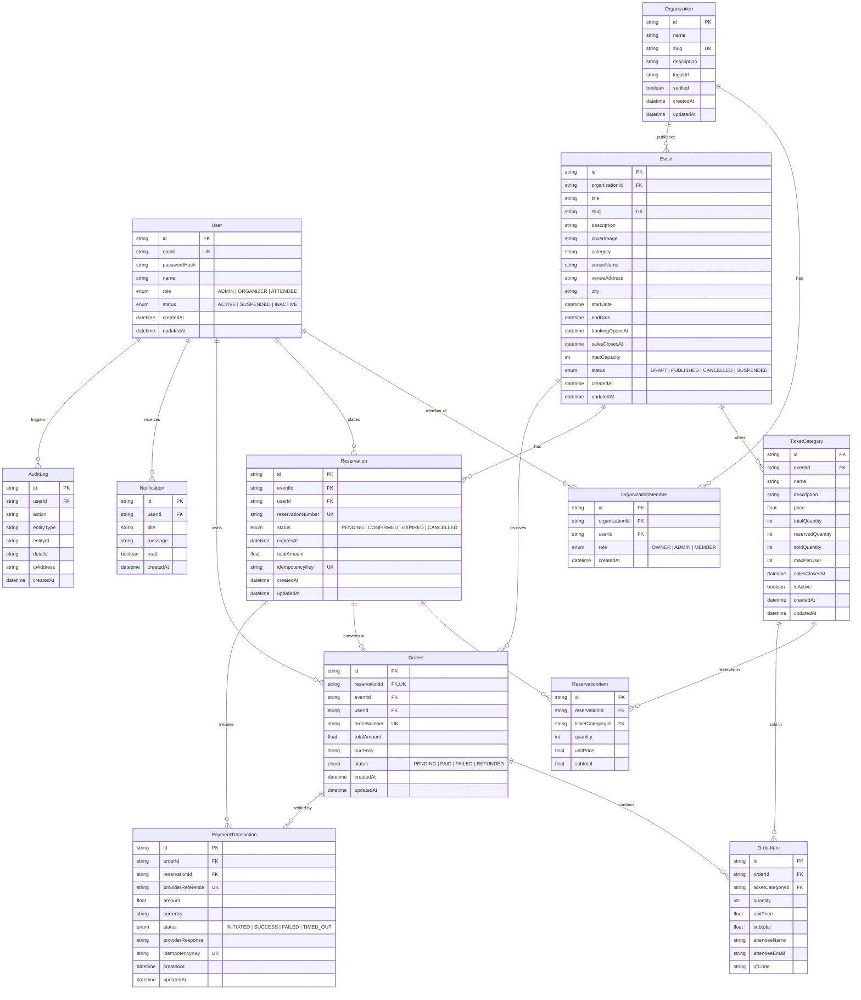

# TicketNest Entity-Relationship (ER) Architecture

The following Mermaid diagram models the complete normalized PostgreSQL relational database schema for TicketNest:

## Concurrency and Inventory Invariants
1. **Capacity Guarantee**:
   For any ticket category $C$:
   $$\text{reservedQuantity} + \text{soldQuantity} \le \text{totalQuantity}$$
2. **Deterministic Hold**:
   During reservation creation, $\text{reservedQuantity} \leftarrow \text{reservedQuantity} + Q$ inside an isolated transaction.
3. **10-Minute Expiration**:
   If $\text{now} > \text{expiresAt}$ and $\text{status} = \text{PENDING}$, the expiration worker updates $\text{status} \leftarrow \text{EXPIRED}$ and releases $\text{reservedQuantity} \leftarrow \max(0, \text{reservedQuantity} - Q)$.
4. **Idempotent Settlement**:
   Payment callbacks verify whether the reservation is in terminal state; repeat callbacks return `IDEMPOTENT_IGNORED` without creating duplicate orders.
